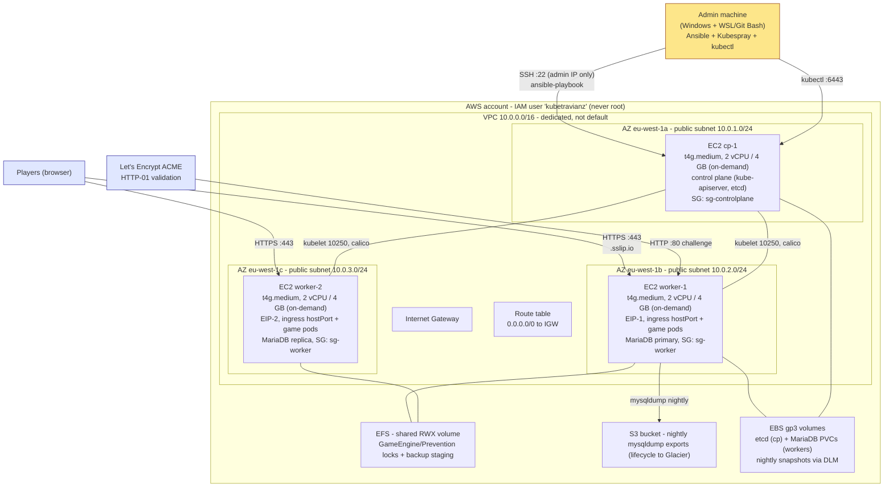

# 02 - AWS infrastructure

## Diagram 1 - AWS infrastructure

## Security groups (default-deny, explicit allows)

| SG | Inbound | Source |
|---|---|---|
| `sg-controlplane` | 22 ssh | admin IP only |
| | 6443 kube-apiserver | admin IP, sg-controlplane, sg-worker |
| | 2379-2380 etcd | sg-controlplane |
| | 10250 kubelet | sg-controlplane, sg-worker |
| | calico VXLAN 4789/udp (+ 179/tcp if BGP) | sg-controlplane, sg-worker |
| `sg-worker` | 22 ssh | admin IP only |
| | 80 / 443 tcp (ingress hostPort) | 0.0.0.0/0 |
| | 10250 kubelet | sg-controlplane |
| | calico VXLAN 4789/udp | sg-controlplane, sg-worker |
| | NodePort 30000-32767 | sg-controlplane, sg-worker (internal tooling only) |
| `sg-efs` | 2049 nfs | sg-worker |

Egress: allow-all (needed for image pulls, ACME, apt). Both SGs start as
**deny-all** and every rule above is added explicitly. That is the checkbox.

## IAM

- Root: locked, MFA, unused.
- IAM user `kubetravianz-admin`: console + CLI, scoped policies (EC2, VPC, EFS,
  S3 bucket, DLM). This is what we operate with.
- Instance profile `kubetravianz-node` on all 3 EC2: SSM (fallback access),
  EFS mount, S3 put on backup bucket, EBS snapshot describe.

## Instances

| Node | Type | Disk | Notes |
|---|---|---|---|
| cp-1 | t4g.medium (on-demand) | 20 GB gp3 | etcd + control plane; nothing else scheduled (taint) |
| worker-1 | t4g.medium (on-demand) | 30 GB gp3 | ingress hostPort + **EIP-1**, MariaDB primary |
| worker-2 | t4g.medium (on-demand) | 30 GB gp3 | ingress hostPort + **EIP-2**, MariaDB replica |

**All on-demand, no spot.** Reliability beats savings for this build: no
reclamation risk, no mid-demo node loss. Cost impact handled in doc 07
(pause-when-idle recovers runway without touching availability while up).

**2 Elastic IPs, one per worker.** The public endpoints (`travianz.<eip>.
sslip.io`, `argocd...`, `dex...`) are immortal: instances can stop, start,
even be replaced; the EIP re-attaches and DNS/certs never change. $3.60/mo
each, gladly paid. Both EIPs resolve for the game hostname; browsers fail
over between workers on their own.

**t4g = ARM64 (Graviton).** ~8% cheaper than t3 on-demand, same 2 vCPU / 4 GiB.
Every image in the stack ships arm64 builds (php, mariadb, ingress-nginx,
cert-manager, ArgoCD, Keycloak, dex, Datadog, efs-csi), verified against each
registry before first apply. The one real cost: CI builds the game image for
arm64 (docker buildx/QEMU, doc 04). Fallback if anything refuses arm64:
t3.medium, ~$2.40/mo per node more expensive.

**Pause/resume stays cheap even on-demand.** Stopped EC2 bills $0 compute
(EBS ~$6/mo + EIPs ~$7/mo still bill). Everything below is Ansible, so
"resume" means start instances plus one sanity playbook; "rebuild from zero"
means the same playbooks from scratch.

Region: pick the closest to the teacher/demo audience (e.g. `eu-west-1`).
Ubuntu 24.04 LTS ARM64 AMIs (lesson learned: AL2023 quirks, no `iptables-nft`
surprises, Kubespray best-tested on Ubuntu).

## Provisioning flow (Kubespray) - everything Ansible, fully reproducible

1. `infra/aws/` Ansible playbooks (amazon.aws collection) create VPC, subnets,
   SGs, IAM role/profile, key pair, and the 3 EC2 instances from a single
   `group_vars` file. Idempotent: re-running converges, never duplicates.
2. `infra/kubespray/` inventory, fed by dynamic inventory from EC2 tags, then
   `ansible-playbook ... cluster.yml`.
3. Container runtime: containerd. CNI: calico (VXLAN; no AWS VPC CNI outside EKS).
4. Post-deploy playbook: taint cp, label workers (`role=ingress`), install
   platform layer (ingress, cert-manager, ArgoCD, dex...), verify.
5. `infra/aws/teardown.yml` destroys everything it created. Rehearse a full
   teardown/rebuild before demo day; reproducibility is the deliverable.

## Bonus: Terraform track

Once the Ansible path is green, re-express VPC + SG + EC2 in Terraform
(`infra/terraform/`) as the IaC bonus. Not the critical path.

## Multi-AZ / multi-region note - and the honest HA ceiling

The cluster is multi-AZ by construction: one node per AZ, workers in two AZs,
MariaDB primary and replica in different AZs, EFS replicated across AZs by
AWS. What survives what:

| Failure | Result |
|---|---|
| worker-1 or its AZ dies | ingress EIP-1 dead, EIP-2 keeps serving; web pods reschedule to worker-2; MariaDB replica promoted manually (runbook, < 5 min) |
| worker-2 or its AZ dies | same, mirrored |
| cp-1 or its AZ dies | **cluster API down until restored**: game keeps running on last-known state (kubelet survives), but no scheduling/ArgoCD/kubectl. Restore from etcd EBS snapshot |
| Region dies | restore from S3 dumps + snapshots into a fresh region (runbook; RPO 24 h) |

The ceiling, stated plainly: with the teacher's fixed 3-instance spine, the
control plane cannot be HA (etcd quorum needs 3 CP nodes) and DB failover is
manual, not automatic (no room for an operator/quorum component). That is the
maximum reliability 3 nodes can buy, and it is what we built.
