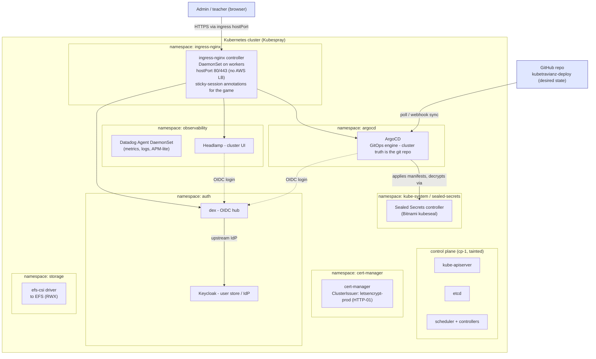

# 03 - Kubernetes platform

Cluster: Kubespray-deployed Kubernetes (v1.30.x line), containerd, calico,
on the 3 EC2 from doc 02. This doc covers the shared platform layer: the
things that exist before TravianZ is deployed.

## Diagram 2 - Platform layer

## Why hostPort instead of a LoadBalancer

AWS charges ~$18/mo per ELB, 9% of the whole budget for something two free
open ports can do. ingress-nginx runs as a **DaemonSet pinned to the two
workers** with `hostPort: 80/443`. Player traffic hits the workers' Elastic
IPs directly. Trade-off, accepted deliberately:

- No LB health checking: if a worker dies, its IP stops answering. Both worker
  EIPs are published for the game hostname; browsers retry the other.
- hostPort bypasses the Service proxy for ingress only; everything behind the
  controller is normal ClusterIP.

## DNS and TLS - sslip.io + Elastic IPs

No domain purchased. `sslip.io` (magic DNS: `54.170.1.2.sslip.io` resolves to
`54.170.1.2`) gives free hostnames that encode a public IP.

- Hostnames: `travianz.<eip>.sslip.io`, `argocd.<eip>.sslip.io`, etc.
- cert-manager issues per-hostname certs via **HTTP-01** (port 80 hostPort is
  reachable; that is the whole trick).
- **Elastic IPs are pinned on both workers** (decided: reliability-first
  build, doc 02). Public IPs never change, so sslip.io hostnames and
  Let's Encrypt certs are immortal across stop/start/replace. An ephemeral-IP
  boot re-render script remains in the repo as the fallback path, but is not
  used in the default build.

## Namespaces

| Namespace | Contents |
|---|---|
| `ingress-nginx` | controller DaemonSet |
| `cert-manager` | cert-manager + ClusterIssuers |
| `argocd` | ArgoCD |
| `auth` | dex, Keycloak (+ its postgres) |
| `observability` | Datadog agent, Headlamp |
| `storage` | efs-csi driver pieces |
| `travianz` | the game (doc 04) |
| `travianz-system` | DB init Job, backup CronJob, sealed secrets for the app |

## Resource guardrails

4 GB per node is tight. Every workload ships with `requests`/`limits`; the
platform layer is budgeted ~1.2 GB per worker, leaving ~2.5 GB for TravianZ +
HPA headroom. Keycloak is the fattest platform pod (~700 MB request); if
pressure shows, Keycloak moves to the control plane node (it has headroom
after etcd).
