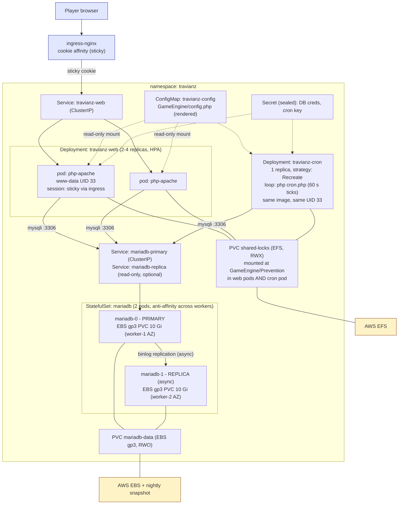

# 04 - TravianZ workloads

The game itself. Constraints below come from *running* it locally
(see doc 01, "application realities").

## Diagram 3 - Application architecture

## The three workload decisions that matter

### 1. Cron: singleton Deployment, not CronJob, not sidecar

- `cron.php` must tick every ~60 s. A K8s CronJob spawning a pod per minute is
  pure overhead for a ~1 s tick, and cron.php's own loop mode
  (`CRON_LOOP_SECONDS=300`) exists precisely to avoid cold starts.
- A **sidecar in every web pod** would run N automations at once: the flock
  mutexes only work per-filesystem, and even on EFS, parallel ticks across pods
  are wasted DB load. Rejected.
- **Singleton Deployment, 1 replica, `Recreate` strategy**, command:
  `while true; do php cron.php --once; sleep 60; done` (or loop mode with
  overlap guard). Pod anti-affinity is not needed at 1 replica; a
  PodDisruptionBudget would just get in the way.
- Same container image, same UID (33 / www-data) as web. The Prevention dir
  is shared; mixed UIDs is exactly the bug we hit on docker compose.

### 2. `GameEngine/Prevention/` must be one shared filesystem

The cron writes `cron_active.txt` every tick; each web request checks it
(< 90 s fresh means "cron alive, I do not run automation"). Separate pod
filesystems would mean web pods never see the marker, so every page load runs
automation: duplicate game ticks and DB races. **EFS PVC (RWX) mounted at
`GameEngine/Prevention/` in web and cron pods.** This is the one hard EFS
dependency; everything else on EFS (backup staging) is convenience.

The rest of the app code is baked into the image (read-only-ish), so no other
RWX need. `var/` (logs) stays per-pod; logs also go to stdout for Datadog.

### 3. Sessions: sticky at the ingress, not Redis (yet)

PHP file sessions are per-pod. Two options: cookie-affinity sticky sessions on
ingress-nginx (one annotation, zero code) or Redis session handler (extra pod,
PHP config change). **Sticky sessions** win for v1: with HPA the ingress
rebalances only new sessions, which is fine for a demo. Redis handler is the
documented upgrade path if horizontal scaling gets tested hard.

## Probes (lesson learned: DB-dependent liveness kills)

| Probe | Path | Rationale |
|---|---|---|
| web liveness | `GET /img/x.gif` (static file) | Never restarts pods just because MariaDB is down |
| web readiness | `GET /login.php` (exercises PHP+DB) | Pulls pod from Service during DB outage instead of serving 500s |
| cron liveness | exec: marker `cron_active.txt` < 120 s old | Detects a hung loop |
| mariadb | `healthcheck.sh --connect --innodb_initialized` (image built-in) | Proven in compose |

## Database - primary + replica (HA build)

MariaDB 11 StatefulSet with **2 pods**: `mariadb-0` primary on worker-1,
`mariadb-1` async replica on worker-2 (pod anti-affinity + EBS zonal pinning
keeps them in different AZs). All game traffic targets the `mariadb-primary`
Service; the replica exists for survival, not read scaling: the game is
write-heavy and read-replica lag would show up as phantom game state.

- Replication: classic binlog, bootstrapped by the init Job (snapshot primary,
  then `CHANGE REPLICATION SOURCE TO` on the replica), verified by a Datadog
  check on `Seconds_Behind_Source`.
- Failover is **manual, runbooked** (`kubectl` + `STOP REPLICA`/`RESET
  BINARY LOGS AND GTIDS`, repoint the primary Service selector, ~5 min). With
  3 fixed nodes there is no quorum for safe auto-failover: a wrong
  auto-promotion would split-brain the game. Deliberate choice, documented.
- `sql_mode=""` (the legacy-code requirement) carries over as a ConfigMap'd
  my.cnf fragment on both pods.
- Nightly logical dumps (doc 07) run against the **replica**: zero backup load
  on the primary.

## Image strategy

One image (`Dockerfile` in repo root, php:8.3-apache + ext) serves web, cron,
and the DB-init Job; only the command differs. Source code is baked into the
image for K8s (the compose bind-mount is a dev-only convenience). Built by
GitHub Actions, pushed to GHCR, rolled out by ArgoCD (doc 05). **ARM64:**
nodes are t4g (Graviton), so CI builds `linux/arm64` via docker buildx/QEMU
(php:8.3-apache is multi-arch, extensions compile cleanly on arm64); building
`linux/amd64` too costs one extra flag and keeps local docker-on-x86 dev
working from the same tag.
