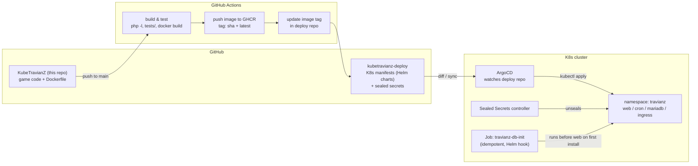

# 05 - GitOps, secrets and install automation

## Diagram 4 - GitOps flow

## Repo split

- **This repo** stays the application: code, Dockerfile, tests, and (new)
  `deploy/` Helm chart for the game itself.
- **Deploy repo** (`kubetravianz-deploy`, can start as a `deploy/` dir promoted
  later): rendered values, environment overlays, sealed secrets. ArgoCD watches
  it. App-of-apps pattern: one root Application pointing at platform charts
  plus travianz.

## The install wizard problem, solved declaratively

Recap of the enemy: the wizard writes `GameEngine/config.php`, renames
`install/` away, touches `var/installed`, and generates a random table prefix
in a PHP session. None of that belongs in a cluster. Solution, three parts:

### a) config.php as rendered ConfigMap

`install/data/constant_format.tpl` is already a `%TOKEN%` template. A small
render step (Helm `tpl` or envsubst in an init container) produces
`config.php` from Helm values (server name, speeds, world size, feature flags
like the new tribes, DB creds from the sealed secret) plus the fixed answers
the wizard would have asked. Mounted read-only at `GameEngine/config.php`.
Admin-panel config editing is sacrificed on the GitOps altar: edits happen in
git. Documented as a deliberate trade-off.

The values baseline is the current local `GameEngine/config.php` (including
all 27 enabled feature flags and newsbox settings), so no tuning gets lost
on the move to K8s.

### b) DB init Job (idempotent)

Port of `scripts/install_headless.py` (proven locally: config, structure,
world data, croppers, accounts in ~6 s on a 100x100 world) into a CLI PHP
script that runs in-cluster:

1. If the `<prefix>users` table exists, exit 0 (idempotent).
2. Else call the same `Admin/database.php` functions the wizard does:
   `createDbStructure()`, `populateWorldData()`, `populateCroppers()`.
3. Seed Multihunter/Support/Nature/Taskmaster + admin account (credentials
   from sealed secret).
4. The `var/installed` equivalent: a marker row or ConfigMap.

Runs as a Helm pre-install/pre-upgrade hook or ArgoCD sync wave before web.
The random table prefix becomes a Helm value (`s1_` default); the randomness
was only security-through-obscurity anyway.

### c) install/ directory ships but is dead

The K8s image does not serve `/install` (or the ingress blocks it). The wizard
remains available for local docker-compose dev, where it belongs.

## Secrets

- **Sealed Secrets** (kubeseal): DB password, cron HTTP key, dex/Keycloak
  client secrets, Datadog API key. Encrypted blobs live in the deploy repo;
  only the cluster controller can decrypt.
- No secrets in Helm values plaintext; CI has a `grep` guard for that.

## Rollout defense mechanism

Per the roadmap: ArgoCD `syncPolicy` with `selfHeal: true` (drift gets
reverted), web Deployment with `strategy: RollingUpdate maxUnavailable: 0`,
plus `preStop` drain. A failed rollout leaves the old ReplicaSet serving;
ArgoCD marks Degraded and the demo keeps running. Rollback is `git revert`
plus sync.
