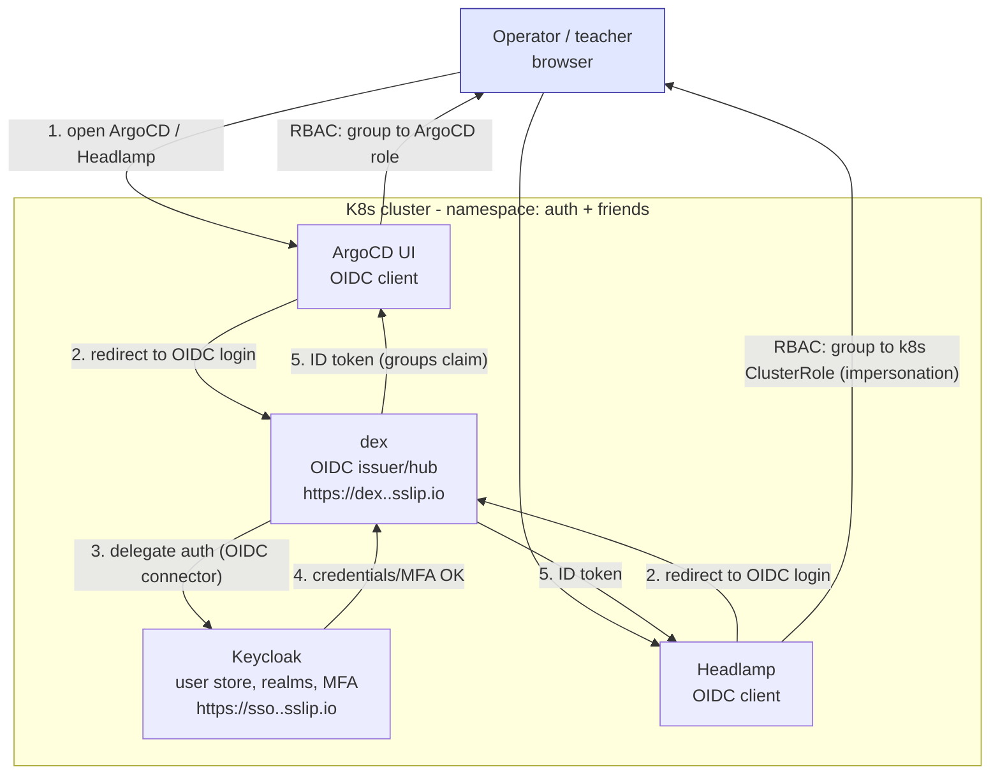

# 06 - Auth / SSO (dex everywhere)

Teacher's checkbox: **DEX everywhere**. Interpretation: every web UI we expose
for operations sits behind dex OIDC. The game itself keeps its own accounts
(it is a game: players register in-game; bolting OIDC onto legacy PHP auth is
out of scope and noted as such).

## Diagram 5 - SSO flow

## Pieces

| Piece | Role | Notes |
|---|---|---|
| **dex** | Single OIDC issuer for the cluster | Static-password connector for the first green build; Keycloak connector as soon as Keycloak is up |
| **Keycloak** | User store / identity provider | Realm `kubetravianz`, users for team + teacher demo account, groups `platform-admin` / `viewer`. Postgres backend (tiny StatefulSet) so users survive restarts |
| **ArgoCD** | OIDC client of dex | `dex` connector in argocd-cm; RBAC maps dex groups to ArgoCD roles |
| **Headlamp** | OIDC client of dex | Uses token + impersonation headers; read-only role for the teacher account |
| **Datadog** | External SaaS | Not dex-able on free tier; dashboard link is published, auth is Datadog's own invite. Documented exception |

## What is deliberately NOT behind dex

- The game (`travianz.<eip>.sslip.io`): public, its own registration/login.
- phpMyAdmin: **not deployed in K8s at all** (compose dev tool only; DB access
  in cluster is `kubectl exec` or a port-forward). One less thing to secure.

## Dex everywhere, honestly

If the teacher asks "did you use dex for everything": every cluster-internal
UI yes; the game has legacy in-game auth by design; Datadog SaaS cannot.
That answer plus a live demo of ArgoCD + Headlamp login through dex and
Keycloak should land the checkbox.
