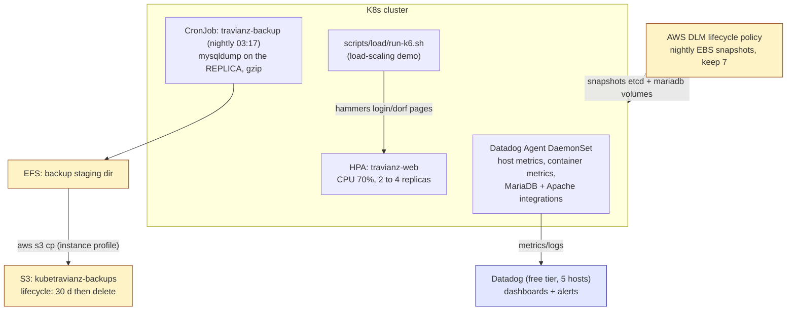

# 07 - Observability, backups and budget

Operating stance: **owner's credits, reliability-first, all on-demand.**
Cost work is duty cycle (pause when idle), not spot instances.

## Diagram 6 - Ops plane

## Monitoring (teacher checkbox: dashboard)

- **Datadog free tier** (5 infrastructure hosts, 1-day metric retention):
  agent DaemonSet + Cluster Agent. Dashboards: node CPU/mem/disk, pod restarts,
  MariaDB QPS/slow queries, Apache RPS. Alerts: cron marker stale > 3 min
  (game heartbeat dead), cert expiry, `Seconds_Behind_Source` on the replica.
- **Headlamp** behind dex (doc 06) for the live "show the teacher the cluster"
  moment.
- No Prometheus/Grafana stack: on 4 GB nodes the RAM cost is real, Datadog is
  free, and the checkbox says "a monitoring dashboard", not "self-hosted".

## Backups (bonus checkbox)

1. **CronJob nightly**: `mysqldump --single-transaction` against the replica,
   gzip to EFS staging, then `aws s3 cp` (node instance profile, no keys in
   the pod). 30-day lifecycle.
2. **EBS snapshots** via AWS Data Lifecycle Manager: etcd volume + both
   MariaDB PVC volumes, nightly, keep 7.
3. Restore drill is part of the demo script: snapshot to new volume to fresh
   cluster, init Job skipped (DB present), game back.

## Load-scaling scripts (teacher checkbox)

- `scripts/load/run-k6.sh`: k6 scenario register, login, village overview
  loop, ramp 0 to 100 VUs. Numbers captured for the report.
- HPA on `travianz-web` (CPU 70%, 2-4 replicas) reacts live; sticky sessions
  keep players consistent while scaling.
- `infra/kubespray/scale-worker.yml`: add a 3rd worker to inventory + run
  Kubespray `scale.yml`; documented as the horizontal-node answer (Cluster
  Autoscaler/Karpenter noted as the "real world" upgrade, not built: ASG
  machinery vs demo value).

## Budget - reliability-first, $200 credits, t4g (ARM64)

On-demand reference: t4g.medium = $0.0384/h = **$28.05/mo**. No spot anywhere:
availability is the point of this build.

| Item | Monthly |
|---|---|
| 3x t4g.medium on-demand (24/7) | $84.15 |
| 2 Elastic IPs (workers) | $7.20 |
| EBS gp3 ~90 GB (etcd + 2x MariaDB PVCs + root) | ~$7.20 |
| EFS + S3 backups | ~$1.00 |
| Data transfer | ~$5.00 |
| **Total** | **~$105/mo, ~1.9 mo runway on $200** |

**Runway lever: pause when idle.** Stopped instances bill only EBS + EIPs
(~$13/mo). Because EIPs are pinned, resume is start-instances plus one sanity
playbook with **zero DNS/cert churn**; that is exactly what the EIPs buy.

| Duty cycle | Monthly | Runway |
|---|---|---|
| 24/7 all semester | ~$105 | ~1.9 mo |
| Paused 50% (dead weeks) | ~$60 | ~3.3 mo |
| Paused 70% (demo-days only) | ~$38 | ~5.2 mo |

The course calendar decides the duty cycle; the Ansible teardown/rebuild
rehearsal (doc 02) guarantees pausing never costs setup time.

Optimizations kept (cheap, not fragile): ARM64 t4g pricing, no AWS LB
(ingress hostPort, doc 03), Datadog free tier, Let's Encrypt, sslip.io.

Check the credit **expiry date** in the console: runway math means nothing if
credits die before the course ends.

## Risks accepted (stated for the report)

- **Single control plane**: etcd quorum is impossible on the teacher's
  3-instance spine. cp-1 loss means API down, game keeps running on
  last-known state; restore from etcd snapshot. Documented ceiling (doc 02).
- **Manual DB failover**: no quorum for safe auto-promotion on 3 nodes;
  runbook targets < 5 min, rehearsed before demo day.
- Replica lag: async replication means an AZ-loss failover can lose seconds
  of game state; acceptable for a course game, mitigated by 24-h S3 dumps.
